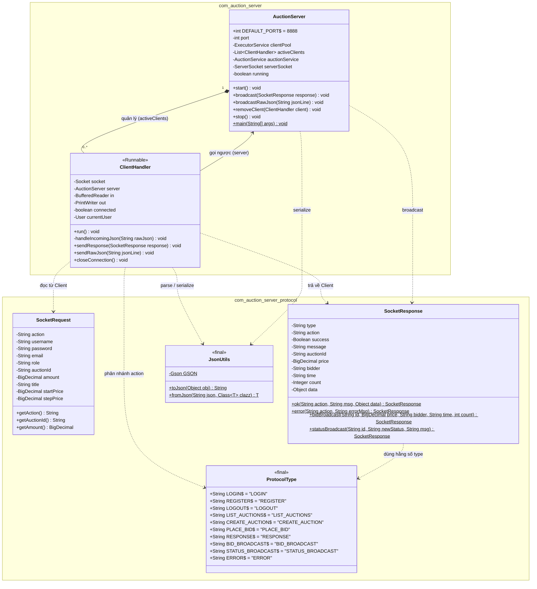

# Thiết kế Module B – Server & Mạng (`com.auction.server`)

Tài liệu này mô tả thiết kế lớp (UML Class Diagram) cho **Bước 1 (Giao thức JSON)** và **Bước 2 (Server Socket đa luồng)**.
*(GitHub hỗ trợ hiển thị trực tiếp biểu đồ Mermaid dưới đây).*

## Sơ đồ lớp (UML Class Diagram) — Bước 1 & Bước 2

